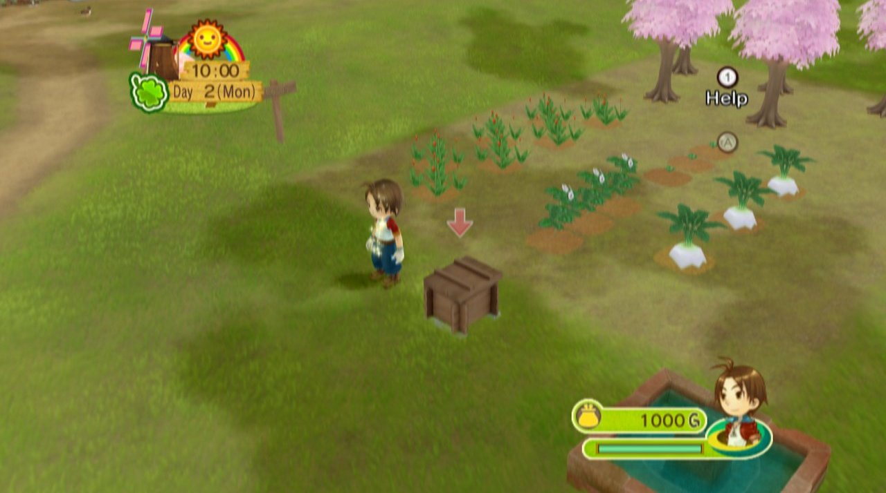
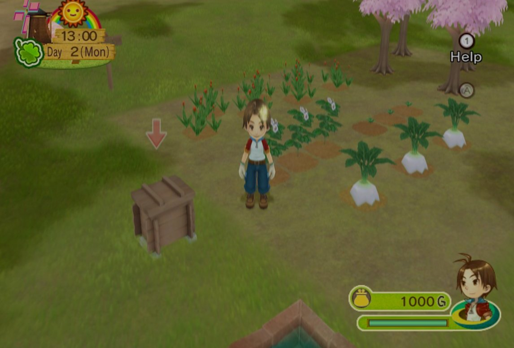
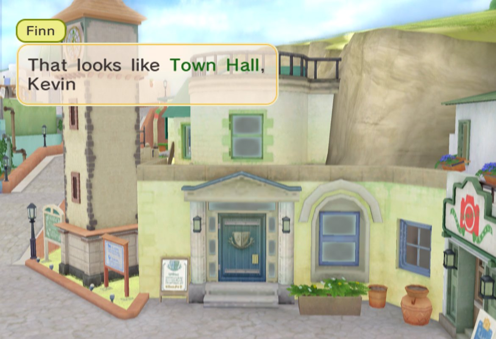

# Harvest Moon: Animal Parade – port nativo para PC

[English](README.md)

Port nativo para PC de *Harvest Moon: Animal Parade* (Wii) por recompilación estática: el
código PowerPC del juego se traduce a C++ y se compila para tu computadora, y la Wii que el
juego espera la pone el runtime de [WiiCompiled](https://github.com/patchzyy/wiicompiled). No
hay emulador. Sigue el mismo camino que la recompilación de *Magical Melody*
([HMMMGC](https://github.com/RodoLy/hmmmgc)).

**Este repositorio no contiene datos del juego.** Necesitas tu propio disco: `Harvest Moon:
Animal Parade (USA)`, ID `RBIEE9`, revisión 1 (`sys/main.dol` SHA-1
`6ca574d26858941bfd1404b0293ef84bd821ddd0`).



## Qué añade este port

Recién instalado, el juego se ve y se juega como en la Wii: imagen 4:3, 30 cuadros por
segundo, en inglés. Todo lo de abajo, menos la carga rápida, se elige en el menú **F10**.

| | |
|---|---|
| **Nativo en Windows x64 y Windows en ARM** | Dos paquetes: x86-64, y ARM64 para laptops Snapdragon X, para que el juego corra nativo y no con la emulación de x86-64. |
| **Imagen ancha** | *F10 > Graphics > Picture > Wide* llena una ventana panorámica: las cámaras 3D ven más a los lados, y los menús y textos conservan su forma en el centro. |
| **Interpolación de cuadros** | El juego corre a 30 FPS; *F10 > Graphics > Frame interpolation* muestra 60, 120 o 180 FPS metiendo cuadros intermedios. La velocidad del juego no cambia. |
| **Carga rápida** | Siempre activa: las pantallas negras entre zonas pasan cuatro veces más rápido. Mantener **Tab** acelera todo (apagado de inicio; se activa en F10). |
| **Cinco idiomas** | Inglés, español, francés, alemán e italiano desde el mismo disco de EE. UU. (ver abajo). |
| **Direct3D 12 o Vulkan** | *F10 > Graphics > Graphics API*. *Automatic* elige Direct3D 12. |
| **Sin Wii Remote** | Un Wii Remote con Nunchuk emulado que se maneja con mando o teclado; el mouse es el puntero. También se puede emparejar un Wii Remote real. |

| Original (4:3) | Ancha |
|---|---|
|  |  |



### Los idiomas, y por qué el disco de EE. UU. los tiene

El disco de EE. UU. ya trae los textos del juego en cinco idiomas: `files/msglang/`,
`talk_la/`, `event_la/`, `param_la/` y `cg_la/` tienen carpetas `eng`, `spa`, `fre`, `ger` e
`ita` (más `bri`, inglés británico). La versión europea y la de EE. UU. comparten esos textos;
la de EE. UU. simplemente nunca los usa, porque su función que elige el idioma (0x8010FF04)
siempre contesta inglés. El port contesta esa función, y la `SCGetLanguage` de la Wii, con el
idioma que elijas en *F10 > Graphics > Language*. Reinicia el juego después de cambiarlo.

Problema conocido: en cualquier idioma que no sea inglés, la pantalla de título muestra el logo
japonés. El disco de EE. UU. solo trae el logo japonés y el inglés; el europeo no viene.

## Jugar en Windows

1. En la pestaña **Actions**, corre **Windows x64 package** o, en una PC con Windows en ARM,
   **Windows ARM64 package**, y descarga el paquete (no trae datos del juego).
2. Descomprímelo en una carpeta corta, como `C:\HMAP`.
3. Haz doble clic en `play.cmd` y elige la imagen de tu disco (.rvz, .iso o .wbfs). La primera
   vez extrae el disco, traduce el juego y lo compila; luego el juego arranca.

Los pasos completos están en [packaging/windows/README.txt](packaging/windows/README.txt). La
configuración, las partidas y los registros quedan en `UserData\`.

## Preguntas frecuentes

**La primera vez tarda varios minutos en abrir.** La primera vez, `play.cmd` extrae el disco,
traduce el código del juego y lo compila. Las siguientes solo compila lo que cambió.

**El juego va lento en una laptop con Windows en ARM (Snapdragon X).** Usa el paquete ARM64.
El de x64 también funciona ahí, pero con la emulación de x86-64, que es más lenta.

**La imagen sale partida a la mitad, o hay cosas que parpadean (Snapdragon X / GPU Adreno).**
Es un driver de gráficos Adreno viejo con Direct3D 12. Actualiza el driver con la app
*Snapdragon Control Panel* (Microsoft Store) o la app de soporte del fabricante de tu laptop.

**Vulkan se detiene con "Device lost", va lento o muestra colores raros.** Algunas GPU, entre
ellas Adreno, solo le dan a Vulkan un modo reducido. Cambia a Direct3D 12 (*Automatic* en
*F10 > Graphics > Graphics API*) y reinicia.

**El contador de FPS dice 30.** El juego corre a 30 cuadros por segundo, como en la Wii. Activa
*Frame interpolation* en F10 para ver 60, 120 o 180 FPS.

**Con la interpolación, en algunas zonas el contador no llega a los FPS elegidos.** En zonas
pesadas, cuando un cuadro del juego llega tarde no hay cuadro que meter para él. La velocidad
del juego no cambia; baja la interpolación o la resolución si te molesta.

**Con la imagen ancha algo se ve mal en las orillas, o un menú se ve estirado.** El juego se
hizo para 4:3. Elige *Original (4:3)* en *F10 > Graphics > Picture* y, por favor, avisa dónde
pasó.

**Cambié el idioma y no cambió nada.** Reinicia el juego: lee el idioma una sola vez, al
arrancar.

**La pantalla de título muestra el logo japonés.** En cualquier idioma que no sea inglés, el
disco de EE. UU. solo tiene el logo japonés para mostrar (ver *Problema conocido* arriba).

**¿Cómo uso el puntero del Wii Remote?** Con el mouse: es el puntero, clic izquierdo es A y clic
derecho es B. Los botones del mando y del teclado se cambian en F10.

**¿Dónde están mis partidas?** En `UserData\NAND\`, junto a la configuración
(`UserData\Config.toml`). Copia toda la carpeta `UserData` para guardarlas.

**El juego se cerró con un mensaje.** El mensaje dice por qué. Abre un issue con él y la
carpeta más reciente de `UserData\Logs`.

**¿Hay trucos?** Por ahora no. Los códigos que cambian las instrucciones del juego no pueden
funcionar en un juego recompilado, y los que solo cambian valores en memoria necesitan
direcciones que todavía se están buscando.

## Para desarrolladores

Necesitas Python 3.11+.

```sh
python3 -m pip install -r requirements-dev.txt   # capstone, pytest, ruff

# 1. Extrae tu disco a orig/RBIEE9 (en Dolphin: clic derecho en el juego →
#    Propiedades → Sistema de archivos → clic derecho en la partición de datos →
#    Extraer partición completa) y comprueba que sea el binario correcto
python3 tools/check_disc.py

# 2. Regenera el mapa de funciones y corre las pruebas
python3 tools/analyze.py
python3 -m pytest

# 3. Lee cualquier función
python3 tools/disasm.py OSInit
```

En Windows usa `py` en lugar de `python3`. En una PC con procesador ARM, instala el Python
**x64**: `capstone` no publica paquete precompilado para Windows ARM64.

Cómo funciona el port: [docs/NATIVE_RUNTIME.md](docs/NATIVE_RUNTIME.md) (el runtime y cada
cambio hecho para este juego), [docs/FUNCTION_MAP.md](docs/FUNCTION_MAP.md) (el mapa de
funciones, 17 142 funciones) y [docs/PLAN.md](docs/PLAN.md).

## Repositorios relacionados

- **[HMMMGC](https://github.com/RodoLy/hmmmgc)**: de ahí vienen las herramientas de `tools/` y
  las pruebas. Funcionaron sin cambios en este juego.
- **Repositorio de investigación de Animal Parade** (descompilación): la organización del
  disco, los nombres originales de archivos y clases, y el menú de desarrolladores oculto.

## Licencia

GNU General Public License, versión 3 o posterior (GPL-3.0-or-later), igual que HMMMGC,
ModernGekko y DolRecomp. El texto completo está en [LICENSE](LICENSE). El juego no se incluye
ni se distribuye; las capturas son del port corriendo un disco original.
