# Harvest Moon: Animal Parade – port nativo para PC

[English](README.md)

<a href="https://recomplauncher.com"><picture><source media="(prefers-color-scheme: dark)" srcset="https://recomplauncher.com/assets/press/launcher/badge-light.svg"></picture></a>

Port nativo para PC de *Harvest Moon: Animal Parade* (Wii) por recompilación estática: el
código PowerPC del juego se traduce a C++ y se compila para tu computadora, y la Wii que el
juego espera la pone el runtime de [WiiCompiled](https://github.com/patchzyy/wiicompiled). No
hay emulador. Sigue el mismo camino que la recompilación de *Magical Melody*
([HMMMGC](https://github.com/RodoLy/hmmmgc)).

**Este repositorio no contiene datos del juego.** Necesitas tu propio disco: `Harvest Moon:
Animal Parade (USA)`, ID `RBIEE9`, revisión 1 (`sys/main.dol` SHA-1
`6ca574d26858941bfd1404b0293ef84bd821ddd0`).

> [!WARNING]
> **Experimental.** El port todavía está en una etapa temprana. Pueden aparecer fallos gráficos,
> sobre todo con la cámara libre y la imagen ancha, y hay escenas que aún no se han probado. Si
> algo se ve mal o el juego se detiene,
> [abre un issue](https://github.com/RodoLy/HarvestMoonAnimalParadeRecomp/issues) con una captura
> y la carpeta más nueva de `UserData/Logs`.

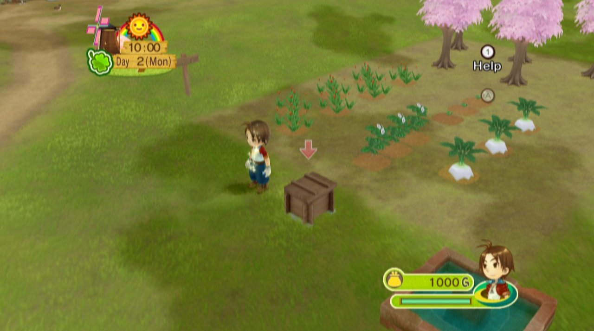

## Qué añade este port

Recién instalado, el juego se ve y se juega como en la Wii: imagen 4:3, 30 cuadros por
segundo, en inglés. Todo lo de abajo, menos la carga rápida, se elige en el launcher o en el
menú **F10** dentro del juego.

| | |
|---|---|
| **Nativo en Windows x64 y Windows en ARM** | Dos paquetes: x86-64, y ARM64 para laptops Snapdragon X, para que el juego corra nativo y no con la emulación de x86-64. |
| **Linux, macOS y Android** | Paquetes para Linux (x86-64 y ARM64, que incluye una Nintendo Switch con switchroot Linux) y Macs con Apple Silicon, y una app de Android (un teléfono, una tableta o una Switch con switchroot Android) con un control Classic en pantalla. Trabajo en progreso: ver abajo. |
| **Imagen ancha** | *F10 > Graphics > Picture > Wide* llena una ventana panorámica: las cámaras 3D ven más a los lados, y los menús y textos conservan su forma en el centro. |
| **Interpolación de cuadros** | El juego corre a 30 FPS; *F10 > Graphics > Frame interpolation* muestra 60, 120 o 180 FPS metiendo cuadros intermedios. La velocidad del juego no cambia. |
| **Hasta 4K** | La *Resolución* en el launcher (o en *F10 > Graphics*) dibuja el juego a 720p, 960p, 1440p, 4K o al tamaño de la ventana en lugar de los 480p de la Wii. 4K le pide mucho a la tarjeta gráfica. |
| **Carga rápida** | Siempre activa: el cambio de zona (el fundido a negro, la carga y el letrero del lugar) va hasta ocho veces más rápido, lo que permita la PC, igual que las demás pantallas negras. Mientras la pantalla está en negro no se dibuja el mundo 3D de detrás, así que hasta una PC lenta pasa rápido. Mantener **Tab** (o la tecla o el botón del control que elijas) acelera todo (apagado de inicio; se activa en el launcher o en F10). |
| **Cámara libre** | Un mod, apagado de inicio (launcher > Mods): al aire libre el stick derecho gira la cámara alrededor del personaje por completo y la inclina, R3 la regresa. [Ver abajo](#cámara-libre). |
| **Amor para todos** | Un mod: cualquiera de los veinte candidatos, con la Diosa y el Rey de la Cosecha, se puede enamorar y casar sin importar el sexo del jugador. [Ver abajo](#amor-para-todos). |
| **Calidad de vida** | Mods para quitar el letrero de la zona al cargar ([ver abajo](#pantallas-de-carga-más-cortas)) y para caminar más rápido (×1.25 a ×3) y actuar más rápido (×1.25 a ×4). Ver [docs/MODS.md](docs/MODS.md). |
| **Trucos** | Estamina, dinero, madera, piedra y alimento infinitos, y detener el tiempo, en el launcher y en F10 (ver las preguntas abajo). |
| **Cinco idiomas** | Inglés, español, francés, alemán e italiano desde el mismo disco de EE. UU. (ver abajo). |
| **Direct3D 12 o Vulkan** | *F10 > Graphics > Graphics API*. *Automatic* elige Direct3D 12. |
| **Sin Wii Remote** | Un Wii Remote con Nunchuk emulado que se maneja con cualquier control conectado (Xbox, PlayStation y otros) o el teclado; el mouse es el puntero. También se puede emparejar un Wii Remote real. |

| Original (4:3) | Ancha |
|---|---|
| 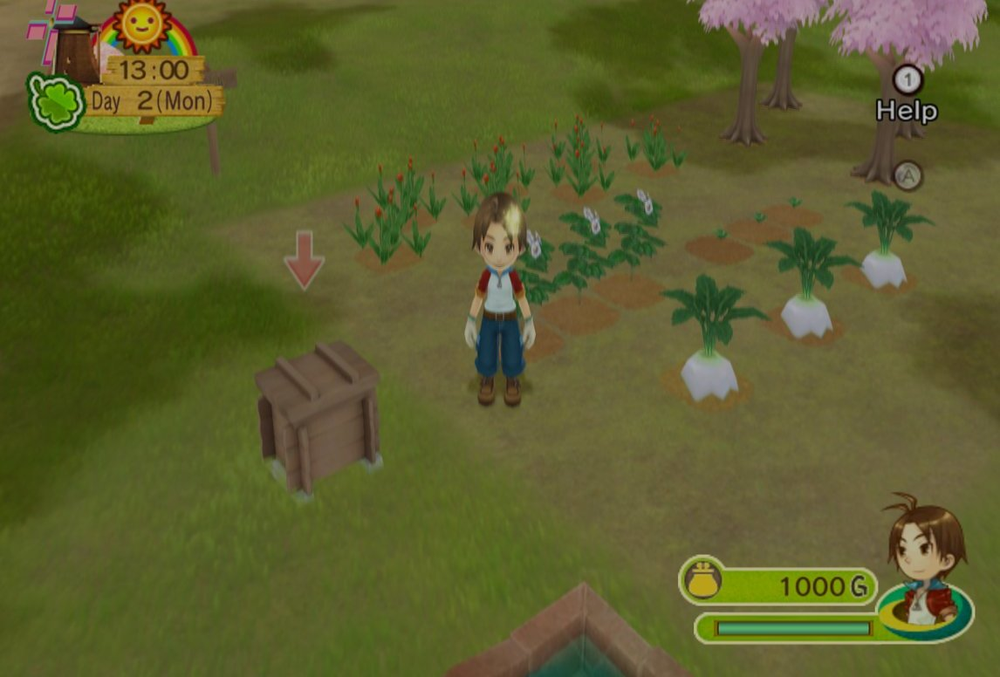 |  |

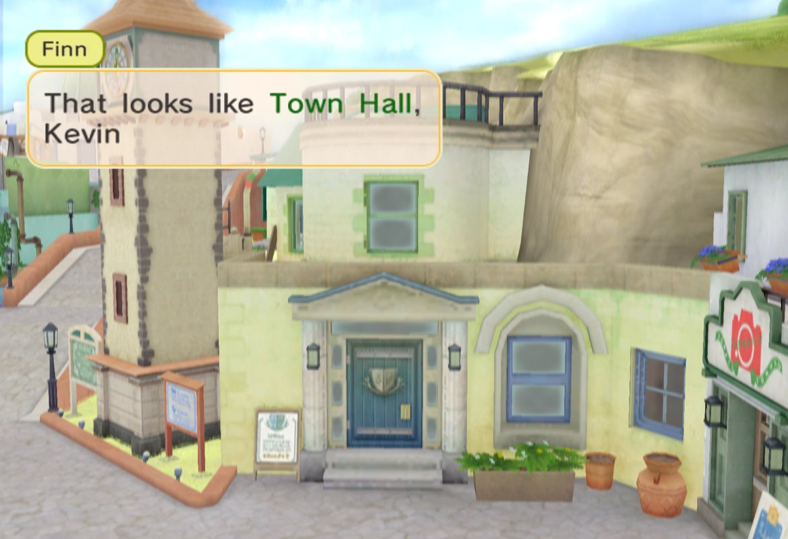

## Pantallas de carga más cortas

En la Wii cada cambio de zona tarda: la pantalla se va a negro, carga la zona siguiente, y luego
aparece un letrero con un dibujo del lugar y su nombre, que se queda un rato y se desvanece antes
de que puedas moverte. En este port el fundido y la carga van hasta ocho veces más rápido, siempre.
Y el mod **Sin letrero de las zonas al cargar** (launcher > Mods, apagado de inicio) quita el
letrero: la zona nueva aparece en cuanto termina de cargar.

| El letrero que quita el mod |
|---|
| 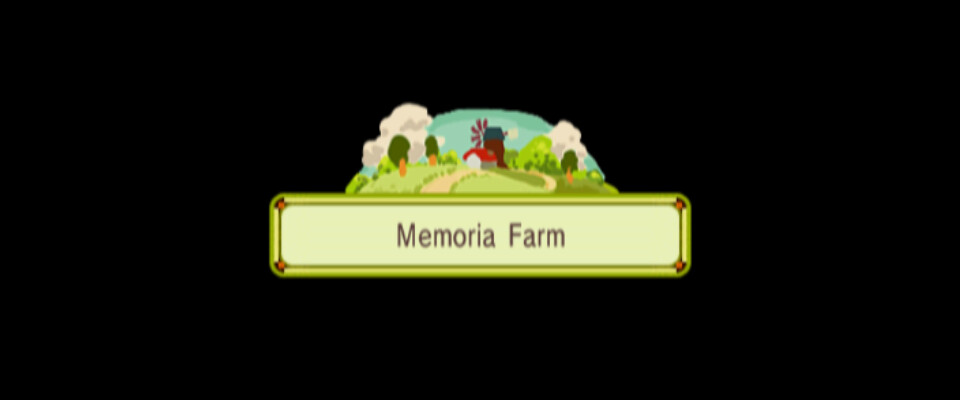 |

## Cámara libre

En la Wii, al aire libre la cámara sigue al personaje desde un solo ángulo fijo. Con el mod
**Cámara libre** (apagado de inicio: se activa en la pestaña **Mods** del launcher) el stick
derecho, o **J L I K** en el teclado, la gira por completo alrededor del personaje y la inclina
desde casi el suelo hasta muy arriba, y **R3** (o **U**) la regresa a donde la tenía el juego. Se
detiene frente a las paredes, mira por encima de las cercas, y en las pláticas se ve la cámara del
propio juego. Sus teclas y botones se eligen en la pestaña Controles del launcher. Cómo funciona:
[docs/FREE_CAMERA.md](docs/FREE_CAMERA.md).

| La cámara del juego | Cámara libre |
|---|---|
| 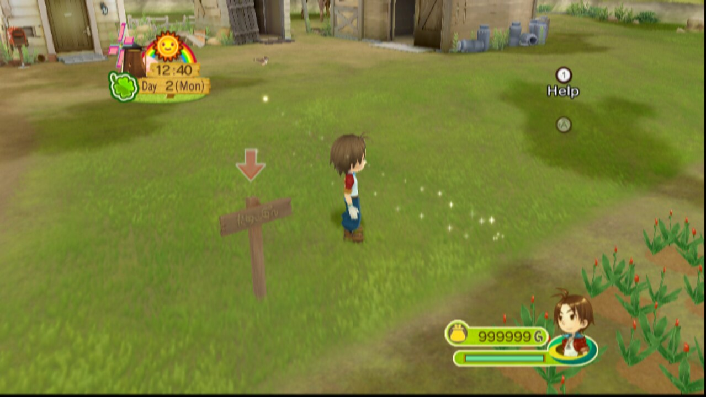 | 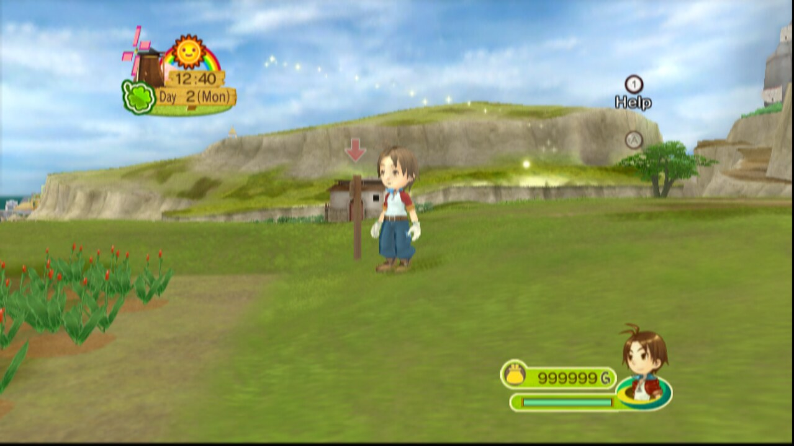 |
| 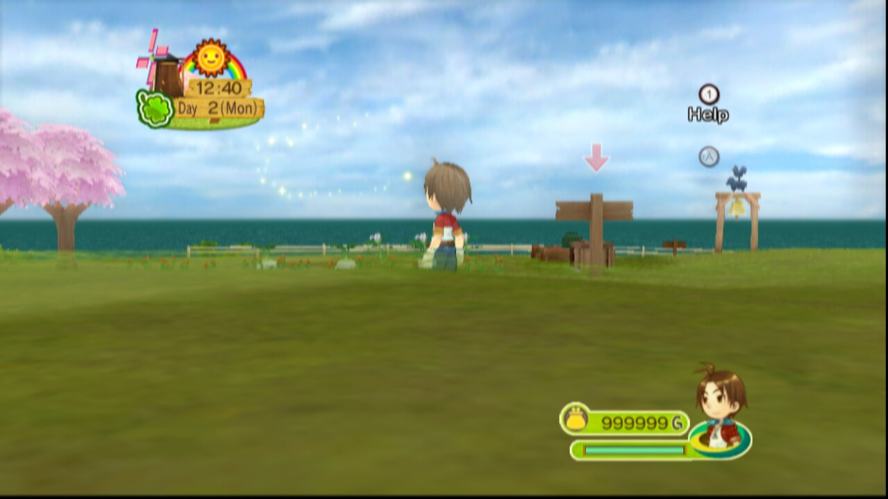 | 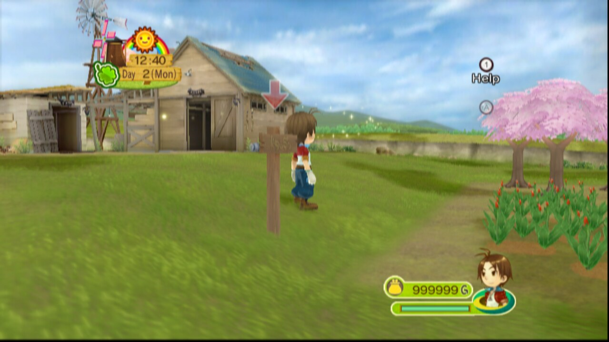 |

Es la parte más nueva del port: de vez en cuando puede haber algún fallo (junto al mar la cámara
se acerca, porque ahí el juego tiene una pared invisible).

## Amor para todos

Con el mod **Amor para todos** (launcher > Mods) cualquiera de los veinte candidatos para casarse,
entre ellos la Diosa de la Cosecha, la Princesa Bruja, el Rey de la Cosecha y el Mago, se puede
enamorar y casar con el jugador, sea hombre o mujer. Sus eventos de corazones, la confesión y la
propuesta se ven como en el juego; los diálogos que hablaban de esposo o esposa se ajustan a la
pareja, la foto de la boda pone a dos novias o dos novios lado a lado, y los hijos llegan por
adopción: un bebé de la Diosa de la Cosecha. Detalles: [docs/MODS.md](docs/MODS.md).

| | |
|---|---|
|  | 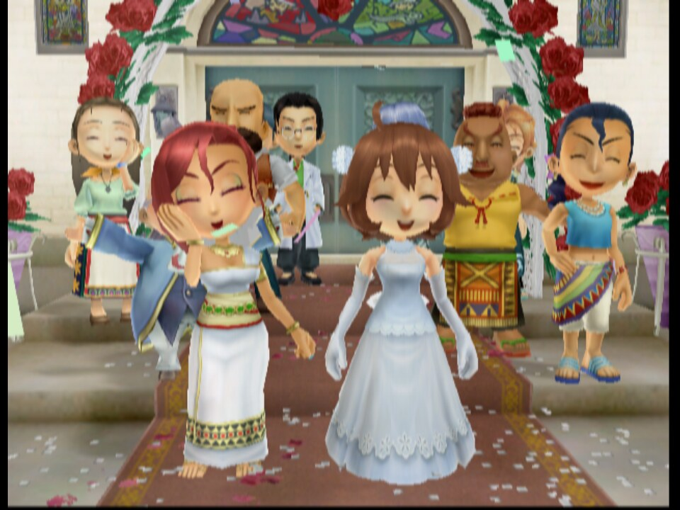 |
| 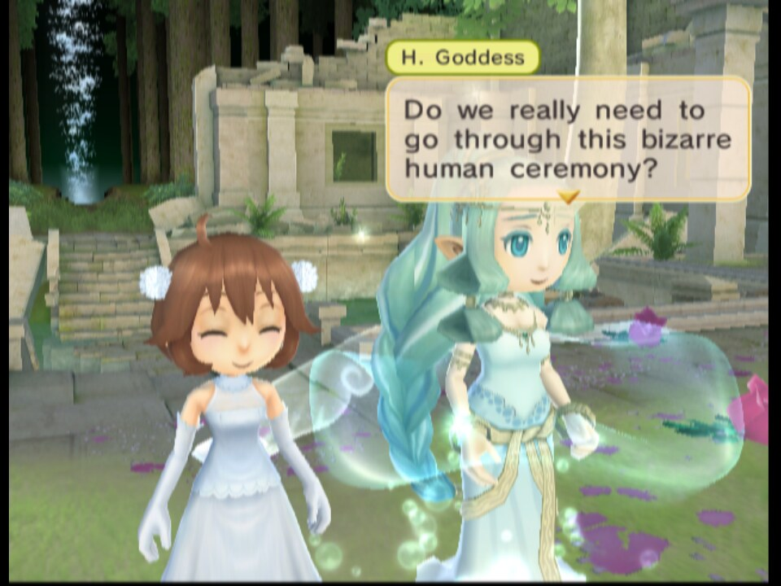 | 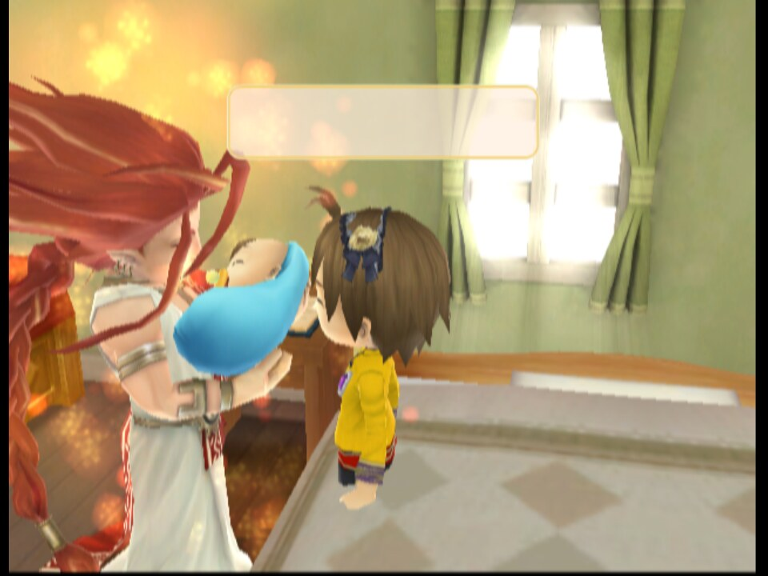 |
| 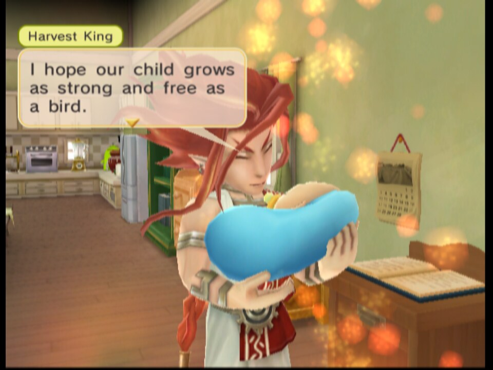 | |

### Los idiomas, y por qué el disco de EE. UU. los tiene

El disco de EE. UU. ya trae los textos del juego en cinco idiomas: `files/msglang/`,
`talk_la/`, `event_la/`, `param_la/` y `cg_la/` tienen carpetas `eng`, `spa`, `fre`, `ger` e
`ita` (más `bri`, inglés británico). La versión europea y la de EE. UU. comparten esos textos;
la de EE. UU. simplemente nunca los usa, porque su función que elige el idioma (0x8010FF04)
siempre contesta inglés. El port contesta esa función, y la `SCGetLanguage` de la Wii, con el
idioma que elijas en el launcher (*Idioma*) o en *F10 > Graphics > Language*. En F10, reinicia el
juego después de cambiarlo.

Problema conocido: en cualquier idioma que no sea inglés, la pantalla de título muestra el logo
japonés. El disco de EE. UU. solo trae el logo japonés y el inglés; el europeo no viene.

## Jugar en Windows

1. En [Releases](https://github.com/RodoLy/HarvestMoonAnimalParadeRecomp/releases), descarga
   `HarvestMoonAnimalParade-windows-x64.zip` o, en una PC con Windows en ARM (Snapdragon X),
   `HarvestMoonAnimalParade-windows-arm64.zip`. No traen datos del juego.
2. Descomprímelo en una carpeta corta, como `C:\HMAP`.
3. Haz doble clic en `play.cmd`. Se abre el launcher: elige la imagen de tu disco (.rvz, .iso o
   .wbfs) y luego **Preparar el juego**. La primera vez extrae el disco, traduce el juego y lo
   compila, lo que tarda varios minutos; después, **Jugar** lo abre al instante.

Los pasos completos están en [packaging/windows/README.txt](packaging/windows/README.txt). La
configuración, las partidas y los registros quedan en `UserData\`.

## Jugar en Linux o macOS

Los paquetes son `HarvestMoonAnimalParade-linux-x86_64.tar.gz`, `-linux-aarch64.tar.gz` (una
Raspberry Pi 5, una Nintendo Switch con switchroot Linux) y `-macos-arm64.zip` (Apple Silicon).
Descomprime uno y abre `AnimalParadeLauncher` (en una Mac, `Animal Parade.command`); se abre en el
navegador y funciona como en Windows. Linux solo necesita un controlador Vulkan: el paquete trae su
compilador y las bibliotecas de C y C++ para compilar, así que no hay que instalar nada (una Steam
Deck funciona tal cual, en modo escritorio). macOS necesita las herramientas de línea de comandos de
Apple (`xcode-select --install`). Los pasos están en [packaging/unix/README.txt](packaging/unix/README.txt).

## Jugar en Android

1. En [Releases](https://github.com/RodoLy/HarvestMoonAnimalParadeRecomp/releases), descarga el
   APK (`HarvestMoonAnimalParade-Android.apk`) e instálalo. Android 11 o más nuevo, de 64 bits, con
   Vulkan; una Nintendo Switch con switchroot Android cuenta.
2. Ábrelo y elige la imagen de tu disco (.iso, .rvz, .wbfs, .wia o .ciso). La app la desempaca una
   sola vez, lo que tarda unos minutos y ocupa unos 5 GB, y arranca el juego. El APK trae el código
   del juego traducido a ARM64 y ninguno de los archivos del disco: esos salen de tu disco.

Sin control, la pantalla muestra un control Classic de Wii: los sticks a los lados, la cruceta,
A B X Y, L y R, y − HOME +. Un dedo en cualquier otro lugar es el puntero del Wii Remote, y ≡ abre
el menú F10. Con un control conectado, el dibujo se oculta tras diez segundos sin tocar la
pantalla, y `touch_controls = false` en `[input]` de `UserData/Config.toml` lo apaga.

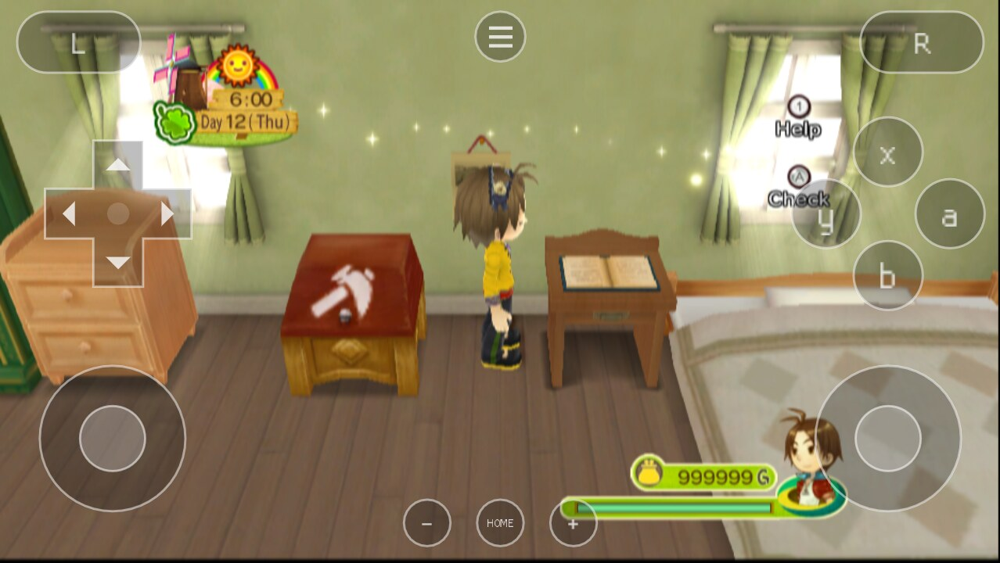

Cómo se hace el APK a partir de un disco está en
[packaging/android/README-Android.txt](packaging/android/README-Android.txt) y
[android/README.md](android/README.md). La versión de Android todavía no se ha probado en muchos
dispositivos.

### El launcher

El launcher prepara y abre el juego y tiene sus ajustes principales: el idioma, la imagen, la
interpolación de cuadros, la resolución, la pantalla completa y la API gráfica. **Controles**
dice arriba si hay un control conectado (y cuál), y a cada botón del Wii Remote y del Nunchuk, y al
avance rápido, le da cualquier tecla o botón del control, en dos columnas; ahí mismo se configuran
los Wii Remotes reales. Está en inglés o en español, y se usa con el mouse, el teclado o un control
(cruceta, A, B, LB y RB). Cuando sale una versión nueva, la pestaña Juego empieza con **Actualizar a
la vX**: con un clic la baja, la pone encima de la carpeta (tus partidas y ajustes se quedan) y
muestra las novedades; sin internet no cambia nada, y *Buscar versiones nuevas* en Opciones lo apaga.

| Juego | Opciones | Controles |
|---|---|---|
| 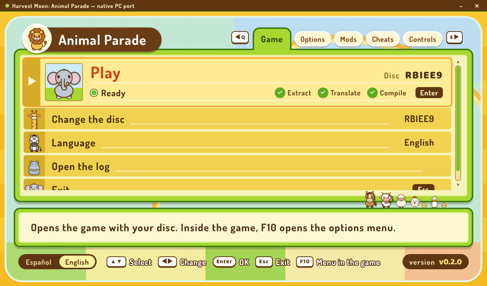 | 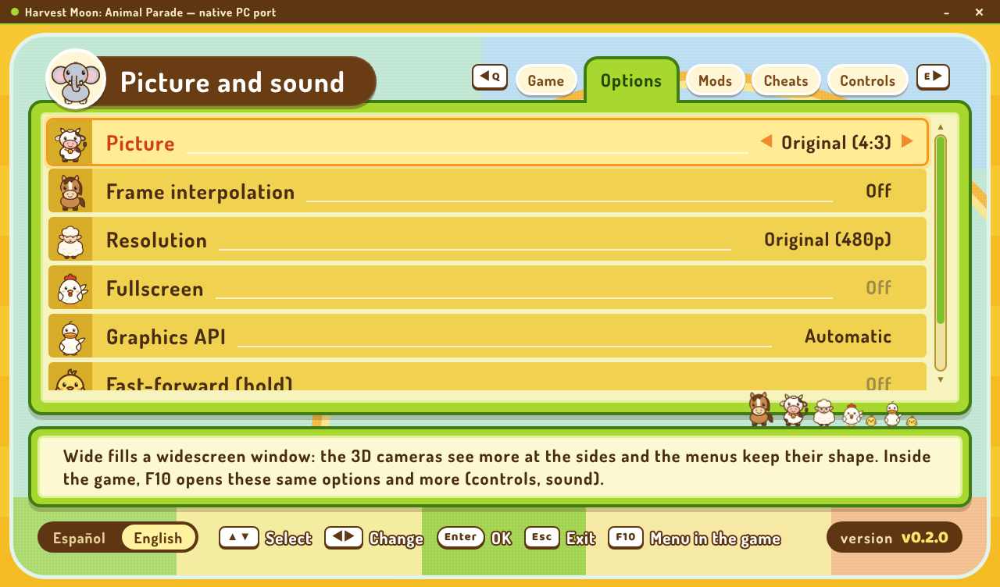 | 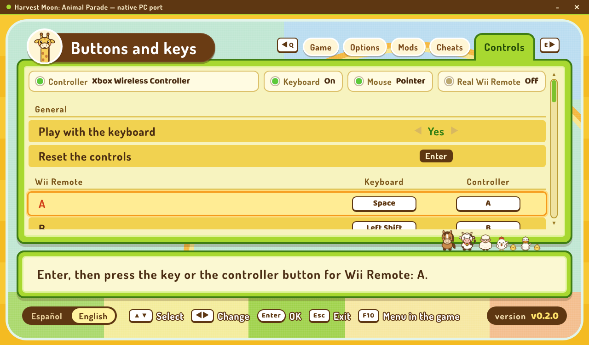 |

En **Mods** cada mod es un interruptor, todos apagados hasta que los actives, así que recién
instalado el juego es el original; los mods de velocidad tienen una barra de ×1.25 a ×3 (×4 para las acciones).

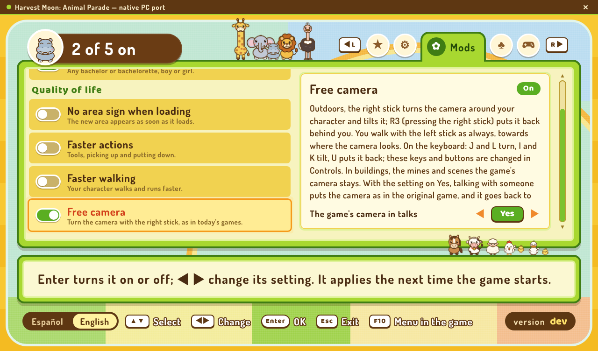

## Preguntas frecuentes

**La primera vez tarda varios minutos en abrir.** La primera vez, `play.cmd` extrae el disco,
traduce el código del juego y lo compila. Las siguientes solo compila lo que cambió.

**El juego va lento en una laptop con Windows en ARM (Snapdragon X).** Usa el paquete ARM64.
El de x64 también funciona ahí, pero con la emulación de x86-64, que es más lenta.

**La imagen sale partida a la mitad, o hay cosas que parpadean (Snapdragon X / GPU Adreno).**
Es un driver de gráficos Adreno viejo con Direct3D 12. Actualiza el driver con la app
*Snapdragon Control Panel* (Microsoft Store) o la app de soporte del fabricante de tu laptop.

**Vulkan se detiene con "Device lost", va lento o muestra colores raros.** Algunas GPU, entre
ellas Adreno, solo le dan a Vulkan un modo reducido. Cambia a Direct3D 12 (*Automatic* en
*F10 > Graphics > Graphics API*) y reinicia.

**La imagen se ve borrosa o de baja resolución.** El juego empieza a los 480p de la Wii, como el
original. Sube la *Resolución* en Opciones del launcher (o en *F10 > Graphics*): 1440p o 4K para una
pantalla grande, o *La de la ventana* para que coincida con la ventana.

**El contador de FPS dice 30.** El juego corre a 30 cuadros por segundo, como en la Wii. Activa
*Frame interpolation* en F10 para ver 60, 120 o 180 FPS.

**Con la interpolación, en algunas zonas el contador no llega a los FPS elegidos.** En zonas
pesadas, cuando un cuadro del juego llega tarde no hay cuadro que meter para él. La velocidad
del juego no cambia; baja la interpolación o la resolución si te molesta.

**Con la imagen ancha algo se ve mal en las orillas, o un menú se ve estirado.** El juego se
hizo para 4:3. Elige *Original (4:3)* en *F10 > Graphics > Picture* y, por favor, avisa dónde
pasó.

**Cambié el idioma y no cambió nada.** Reinicia el juego: lee el idioma una sola vez, al
arrancar.

**La pantalla de título muestra el logo japonés.** En cualquier idioma que no sea inglés, el
disco de EE. UU. solo tiene el logo japonés para mostrar (ver *Problema conocido* arriba).

**¿Cómo uso el puntero del Wii Remote?** Con el mouse: es el puntero, clic izquierdo es A y clic
derecho es B. Los botones del mando y del teclado se cambian en la pestaña Controles del launcher o en F10.

**¿Dónde están mis partidas?** En `UserData\NAND\`, junto a la configuración
(`UserData\Config.toml`). Copia toda la carpeta `UserData` para guardarlas.

**El juego se cerró con un mensaje.** El mensaje dice por qué. Abre un issue con él y la
carpeta más reciente de `UserData\Logs`.

**¿Hay trucos?** Seis, en la pestaña Trucos del launcher y en el menú F10 del juego (Cheats, donde
se activan y desactivan mientras juegas), todos apagados hasta que los
enciendas: estamina infinita, dinero infinito (se queda en 999,999 G), madera infinita, piedra
infinita, alimento infinito (heno y pienso) y detener el tiempo (dormir sí lleva al día
siguiente). Cómo funcionan: [docs/MODS.md](docs/MODS.md). Los códigos que cambian
las instrucciones del juego (Gecko, Action Replay) no pueden funcionar en un juego recompilado.

**¿Funciona con RecompLauncher?** Sí. Cada paquete de computadora trae un `recomplauncher.json`:
RecompLauncher pide tu disco, lo revisa, compila el juego sin ventana, y su botón Jugar abre el
juego; los mods y los trucos salen en la página del juego. Ver
[docs/RECOMPLAUNCHER.md](docs/RECOMPLAUNCHER.md).

## Para desarrolladores

Necesitas Python 3.11+.

```sh
python3 -m pip install -r requirements-dev.txt   # capstone, pytest, ruff

# 1. Extrae tu disco a orig/RBIEE9 (en Dolphin: clic derecho en el juego →
#    Propiedades → Sistema de archivos → clic derecho en la partición de datos →
#    Extraer partición completa) y comprueba que sea el binario correcto
python3 tools/check_disc.py

# 2. Regenera el mapa de funciones y corre las pruebas
python3 tools/analyze.py
python3 -m pytest

# 3. Lee cualquier función
python3 tools/disasm.py OSInit
```

En Windows usa `py` en lugar de `python3`. En una PC con procesador ARM, instala el Python
**x64**: `capstone` no publica paquete precompilado para Windows ARM64.

Cómo funciona el port: [docs/NATIVE_RUNTIME.md](docs/NATIVE_RUNTIME.md) (el runtime y cada
cambio hecho para este juego), [docs/FUNCTION_MAP.md](docs/FUNCTION_MAP.md) (el mapa de
funciones, 17 142 funciones) y [docs/PLAN.md](docs/PLAN.md).

## Repositorios relacionados

- **[HMMMGC](https://github.com/RodoLy/hmmmgc)**: de ahí vienen las herramientas de `tools/` y
  las pruebas. Funcionaron sin cambios en este juego.
- **Repositorio de investigación de Animal Parade** (descompilación): la organización del
  disco, los nombres originales de archivos y clases, y el menú de desarrolladores oculto.

## Licencia

GNU General Public License, versión 3 o posterior (GPL-3.0-or-later), igual que HMMMGC,
ModernGekko y DolRecomp. El texto completo está en [LICENSE](LICENSE). El juego no se incluye
ni se distribuye; las capturas son del port corriendo un disco original.
