# Harvest Moon: Animal Parade – native PC port

[Español](README.es.md)

<a href="https://recomplauncher.com"><picture><source media="(prefers-color-scheme: dark)" srcset="https://recomplauncher.com/assets/press/launcher/badge-light.svg"></picture></a>

A native PC port of *Harvest Moon: Animal Parade* (Wii) by static recompilation: the game's
PowerPC code is translated to C++ and compiled for your computer, and the Wii it expects is
provided by [WiiCompiled](https://github.com/patchzyy/wiicompiled)'s runtime. There is no emulator.
It follows the same path as the *Magical Melody* recompilation
([HMMMGC](https://github.com/RodoLy/hmmmgc)).

**This repository contains no game data.** You need your own disc: `Harvest Moon: Animal
Parade (USA)`, ID `RBIEE9`, revision 1 (`sys/main.dol` SHA-1
`6ca574d26858941bfd1404b0293ef84bd821ddd0`).

> [!WARNING]
> **Experimental.** This port is still in an early stage. Graphical glitches can happen, above
> all with the free camera and the wide picture, and some scenes have not been tried yet. If
> something looks wrong or the game stops, please
> [open an issue](https://github.com/RodoLy/HarvestMoonAnimalParadeRecomp/issues) with a
> screenshot and the newest folder in `UserData/Logs`.

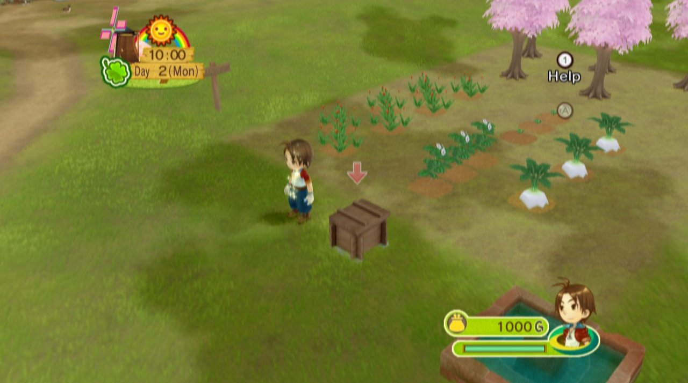

## What this port adds

Out of the box the game looks and plays as it did on the Wii: 4:3 picture, 30 frames per
second, English. Everything below except fast loading is a choice in the launcher or in the
**F10** menu inside the game.

| | |
|---|---|
| **Native on Windows x64 and Windows on ARM** | Two packages: x86-64, and ARM64 for Snapdragon X laptops, so the game runs natively instead of through x86-64 emulation. |
| **Linux, macOS and Android** | Packages for Linux (x86-64 and ARM64, which includes a Nintendo Switch with switchroot Linux) and Macs with Apple Silicon, and an Android app (a phone, a tablet, or a Switch with switchroot Android) with an on-screen Classic Controller. Early work: see below. |
| **Wide picture** | *F10 > Graphics > Picture > Wide* fills a widescreen window: the 3D cameras see more at the sides, and the menus and text keep their shape in the middle. |
| **Frame interpolation** | The game runs at 30 FPS; *F10 > Graphics > Frame interpolation* shows 60, 120 or 180 FPS by inserting frames in between. The game's own speed does not change. |
| **Fast loading** | Always on: the change of area (the fade to black, the loading and the place sign) runs up to eight times faster, as fast as the PC allows, and so do the other black screens. While the screen is black the 3D world behind it is not drawn, so even a slow PC gets through it quickly. Holding **Tab** (or any key or controller button you choose) fast-forwards everything (off by default; turn it on in the launcher or F10). |
| **Free camera** | A mod, off by default (launcher > Mods): outdoors the right stick turns the camera all the way around the player and tilts it, R3 puts it back. [See below](#free-camera). |
| **Romance for everyone** | A mod: any of the twenty marriage candidates, the Harvest Goddess and the Harvest King included, can be courted and married whatever the player's sex. [See below](#romance-for-everyone). |
| **Quality of life** | Mods for no area sign when loading ([see below](#shorter-loading-screens)) and for faster walking (×1.25 to ×3) and faster actions (×1.25 to ×4). See [docs/MODS.md](docs/MODS.md). |
| **Cheats** | Infinite stamina, money, lumber, stone and feed, and stop time, in the launcher and in F10 (see the questions below). |
| **Five languages** | English, Spanish, French, German and Italian from the same US disc (see below). |
| **Direct3D 12 or Vulkan** | *F10 > Graphics > Graphics API*. *Automatic* picks Direct3D 12. |
| **No Wii Remote needed** | An emulated Wii Remote with Nunchuk driven by any connected controller (Xbox, PlayStation and others) or the keyboard; the mouse is the pointer. A real Wii Remote can be paired instead. |

| Original (4:3) | Wide |
|---|---|
| 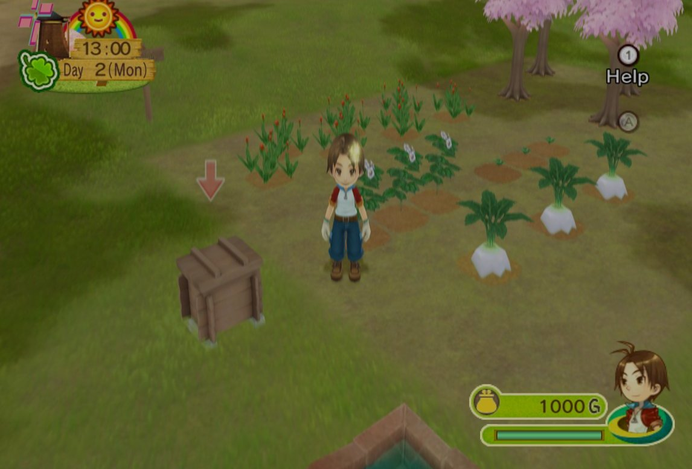 |  |

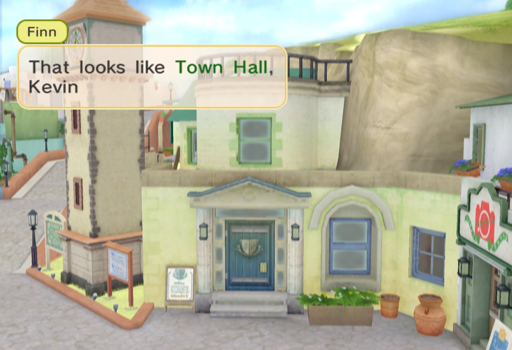

## Shorter loading screens

On the Wii every change of area takes a while: the screen fades to black, the next area loads,
and then a sign with a picture of the place and its name fades in, stays and fades out before you
can move again. In this port the fade and the loading run up to eight times faster, always. And
the **No area sign when loading** mod (launcher > Mods, off by default) takes the sign away: the
new area appears as soon as it has loaded.

| The sign the mod takes away |
|---|
|  |

## Free camera

On the Wii the camera outdoors follows the player from one fixed angle. With the **Free camera**
mod (off by default: turn it on in the launcher's **Mods** tab) the right stick, or **J L I K** on
the keyboard, turns it all the way around the player and tilts it from near the ground to high
above, and **R3** (or **U**) puts it back where the game had it. It stops in front of walls, looks
over fences, and in talks the game's own camera shows. Its keys and buttons are chosen in the
launcher's Controls tab. How it works: [docs/FREE_CAMERA.md](docs/FREE_CAMERA.md).

| The game's camera | Free camera |
|---|---|
| 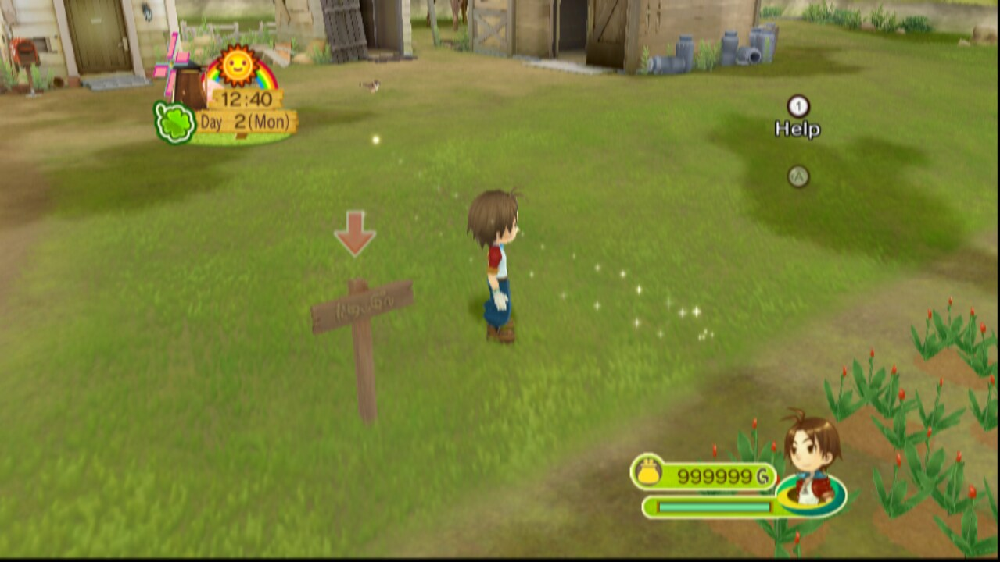 | 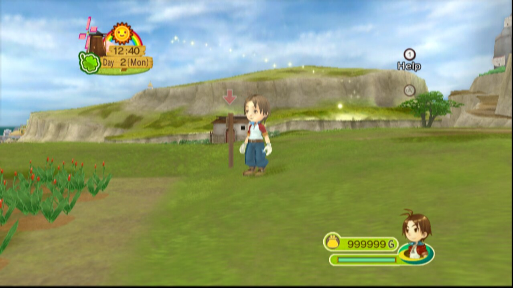 |
| 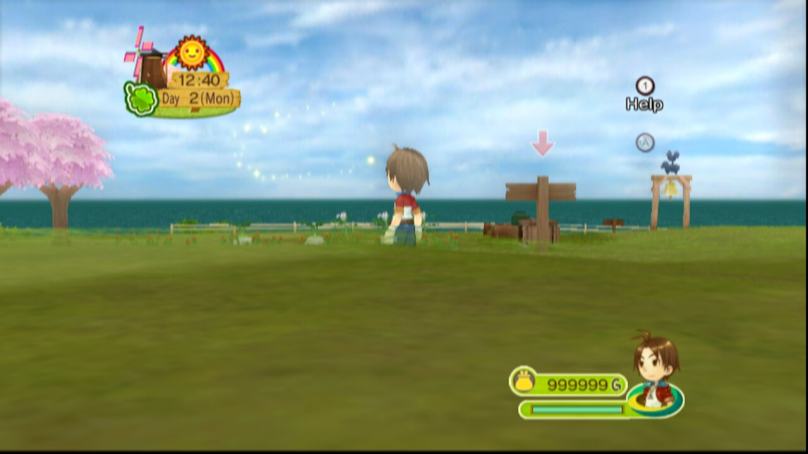 | 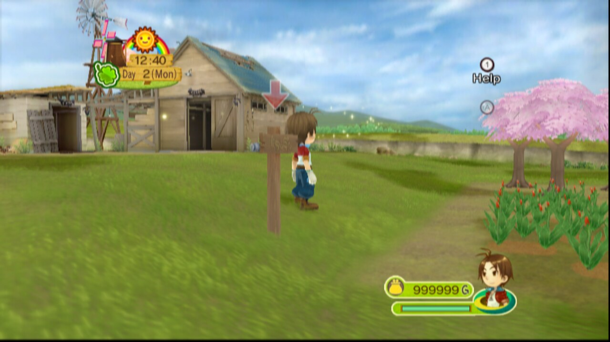 |

It is the newest part of the port: expect a glitch now and then (the camera comes in close by
the sea, where the game has an invisible wall).

## Romance for everyone

With the **Romance for everyone** mod (launcher > Mods) any of the twenty marriage candidates,
the Harvest Goddess, the Witch Princess, the Harvest King and the Wizard among them, can be
courted and married whether the player is a man or a woman. Their heart events, the confession
and the proposal play as in the game; the lines that spoke of a husband or a wife fit the couple,
the wedding photo stands two brides or two grooms side by side, and the children come by
adoption: a baby from the Harvest Goddess. Details: [docs/MODS.md](docs/MODS.md).

| | |
|---|---|
|  | 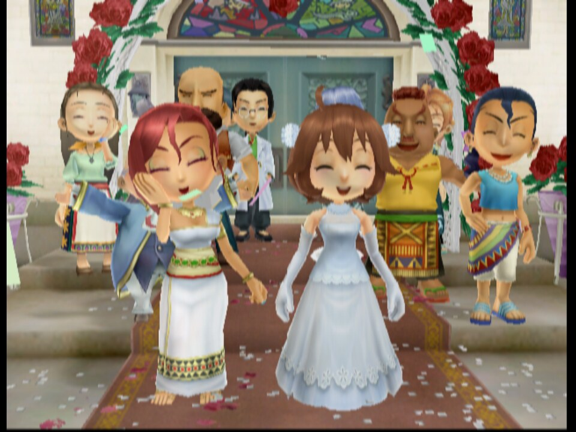 |
| 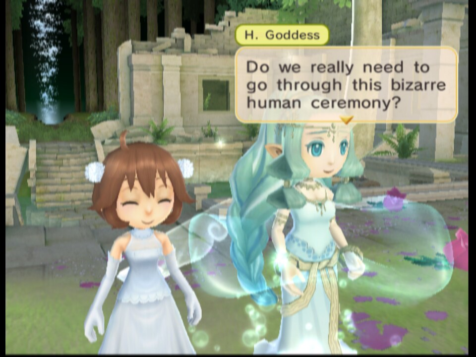 | 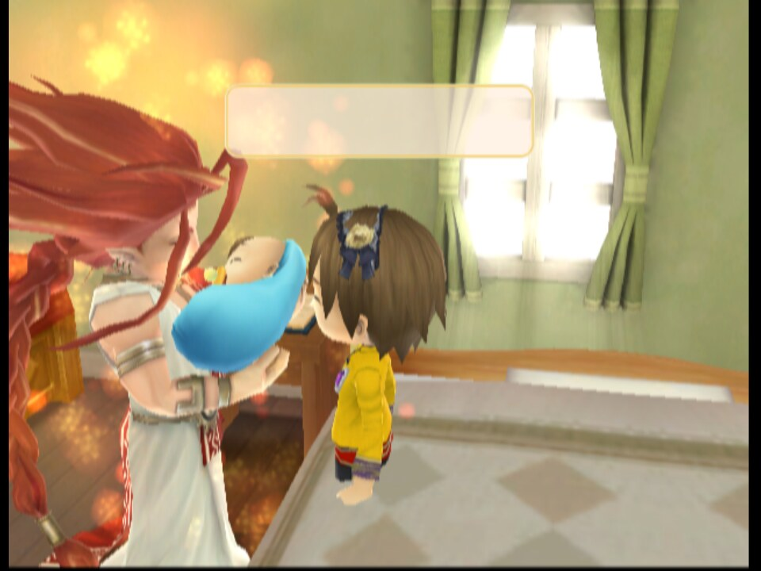 |
| 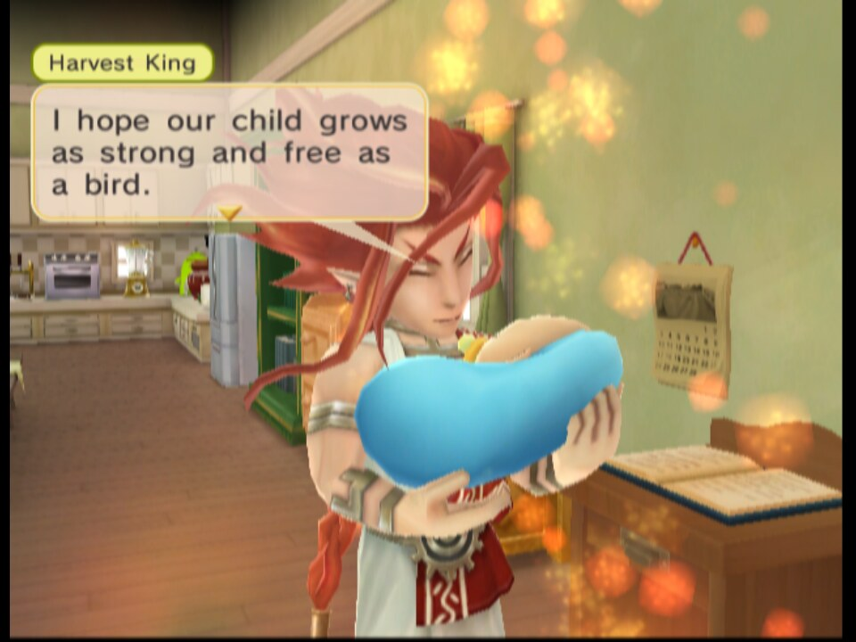 | |

### Languages, and why the US disc has them

The US disc already carries the game's text in five languages: `files/msglang/`, `talk_la/`,
`event_la/`, `param_la/` and `cg_la/` each have `eng`, `spa`, `fre`, `ger` and `ita` folders
(plus `bri`, British English). The European and US releases share that text; the US game
just never uses it, because its function that picks the language (0x8010FF04) always answers
English. The port answers it, and the Wii's own `SCGetLanguage`, with the language you choose
in the launcher (*Language*) or in *F10 > Graphics > Language*. In F10, restart the game after
changing it.

Known issue: in any language other than English the title screen shows the Japanese logo. The
US disc only has the Japanese and the English logos; the European logo is not on it.

## Play on Windows

1. From [Releases](https://github.com/RodoLy/HarvestMoonAnimalParadeRecomp/releases), download
   `HarvestMoonAnimalParade-windows-x64.zip` or, on a Windows on ARM PC (Snapdragon X),
   `HarvestMoonAnimalParade-windows-arm64.zip`. They have no game data.
2. Unzip it to a short folder, such as `C:\HMAP`.
3. Double click `play.cmd`. The launcher opens: choose your disc image (.rvz, .iso or .wbfs),
   then **Prepare the game**. The first time it extracts the disc, translates the game and
   compiles it, which takes several minutes; after that, **Play** starts it right away.

The full steps are in [packaging/windows/README.txt](packaging/windows/README.txt). Settings,
saves and logs are in `UserData\`.

## Play on Linux or macOS

The packages are `HarvestMoonAnimalParade-linux-x86_64.tar.gz`, `-linux-aarch64.tar.gz` (a
Raspberry Pi 5, a Nintendo Switch with switchroot Linux) and `-macos-arm64.zip` (Apple Silicon).
Unpack one, start `AnimalParadeLauncher` (on a Mac, `Animal Parade.command`); it opens in the
browser and works as on Windows. Linux needs the C library's headers (`libc6-dev`) and a Vulkan
driver; macOS needs Apple's command line tools (`xcode-select --install`). The steps are in
[packaging/unix/README.txt](packaging/unix/README.txt).

## Play on Android

1. From [Releases](https://github.com/RodoLy/HarvestMoonAnimalParadeRecomp/releases), download
   the APK (`HarvestMoonAnimalParade-Android.apk`) and install it. Android 11 or newer, 64-bit,
   with Vulkan; a Nintendo Switch with switchroot Android counts.
2. Open it and choose your disc image (.iso, .rvz, .wbfs, .wia or .ciso). The app unpacks it once,
   which takes a few minutes and about 5 GB, and starts the game. The APK carries the game's code
   translated to ARM64 and none of the disc's files: those come from your disc.

Without a controller the screen shows a Wii Classic Controller: the sticks at the sides, the
D-pad, A B X Y, L and R, and − HOME +. A finger anywhere else is the Wii Remote pointer, and ≡
opens the F10 menu. With a controller connected the drawing hides after ten seconds without a
touch, and `touch_controls = false` under `[input]` in `UserData/Config.toml` turns it off.

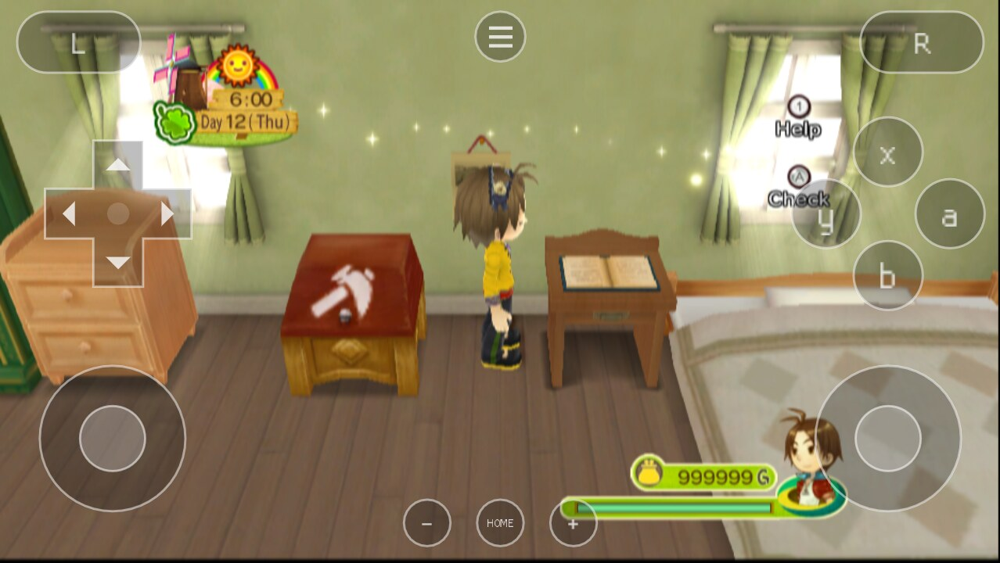

How the APK is made from a disc is in
[packaging/android/README-Android.txt](packaging/android/README-Android.txt) and
[android/README.md](android/README.md). The Android version has not been tried on many devices
yet.

### The launcher

The launcher prepares and starts the game and holds its main settings: the language, the
picture, frame interpolation, resolution, fullscreen and the graphics API. **Controls** shows on
top whether a controller is connected (and which), and gives every Wii Remote and Nunchuk button,
and fast-forward, any key or controller button, in two columns; real Wii Remotes are set up there
too. It speaks English or Spanish, and is driven with the mouse, the keyboard or a controller
(D-pad, A, B, LB and RB).

| Game | Options | Controls |
|---|---|---|
| 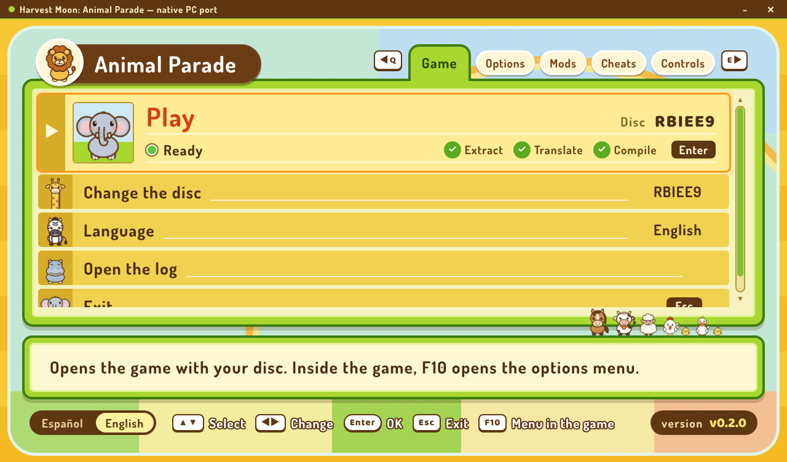 | 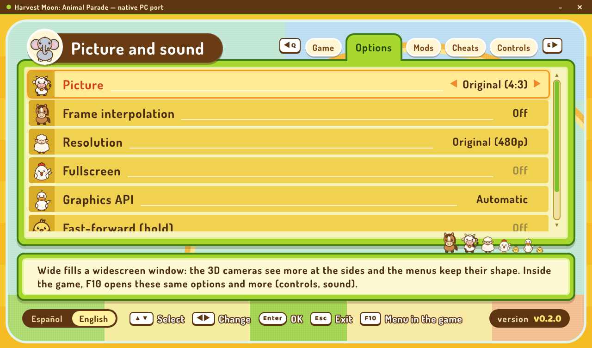 | 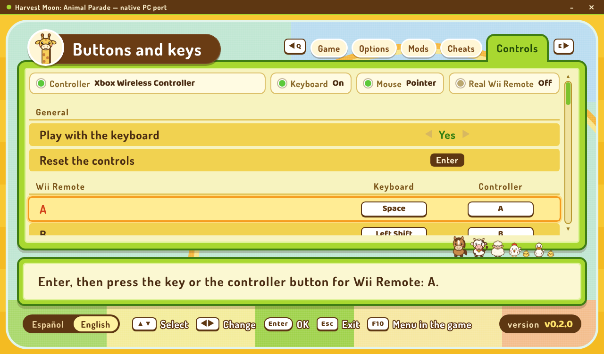 |

In **Mods** each mod is a switch, all off until you turn them on, so out of the box the game is
the original; the speed mods have a bar from ×1.25 to ×3 (×4 for the actions).

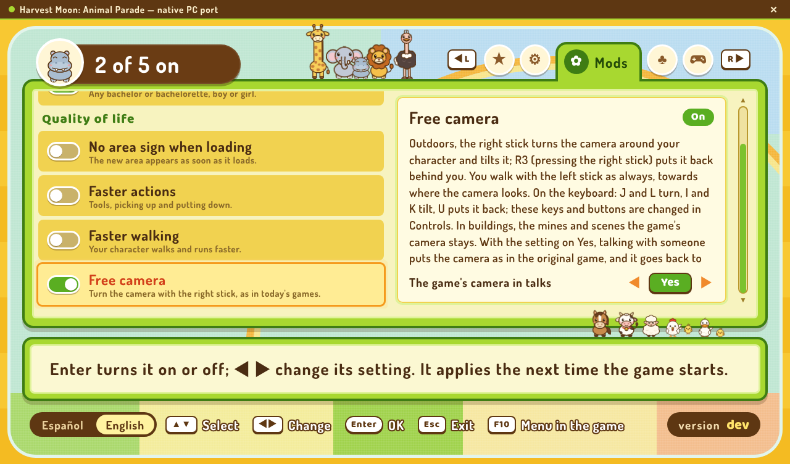

## Frequently asked questions

**The first start takes several minutes.** The first time, `play.cmd` extracts the disc,
translates the game's code and compiles it. Later starts only build what changed.

**The game runs slowly on a Windows on ARM laptop (Snapdragon X).** Use the ARM64 package. The
x64 package also works there, but through x86-64 emulation, which is slower.

**The picture is split down the middle, or things blink (Snapdragon X / Adreno GPU).** That is
an old Adreno graphics driver with Direct3D 12. Update the driver with the *Snapdragon Control
Panel* app (Microsoft Store) or your laptop maker's support app.

**Vulkan stops with "Device lost", runs slowly or shows wrong colors.** Some GPUs, Adreno among
them, only give Vulkan a reduced mode. Switch to Direct3D 12 (*Automatic* in
*F10 > Graphics > Graphics API*) and restart.

**The FPS counter says 30.** The game runs at 30 frames per second, as on the Wii. Turn on
*Frame interpolation* in F10 to see 60, 120 or 180 FPS.

**With frame interpolation the counter stays under the chosen FPS in some areas.** In heavy
areas, when a frame of the game is late there is no frame to insert for it. The game's speed
does not change; lower the interpolation or the resolution if it bothers you.

**Something looks wrong at the edges, or a menu looks stretched, with the wide picture.** The
game was made for 4:3. Choose *Original (4:3)* in *F10 > Graphics > Picture* and please report
where it happened.

**I changed the language and nothing changed.** Restart the game: it reads the language once,
while it starts.

**The title screen shows the Japanese logo.** In any language other than English the US disc
only has the Japanese logo to show (see *Known issue* above).

**How do I use the Wii Remote pointer?** With the mouse: it is the pointer, left click is A and
right click is B. Controller and keyboard buttons can be changed in the launcher's Controls tab or in F10.

**Where are my saves?** In `UserData\NAND\`, next to the settings (`UserData\Config.toml`).
Copy the whole `UserData` folder to keep them.

**The game closed with a message.** The message says why. Please open an issue with it and the
newest folder in `UserData\Logs`.

**Are there cheats?** Six, in the launcher's Cheats tab and in the game's F10 menu (Cheats, where
they can be turned on and off while playing), all off until you turn them
on: infinite stamina, infinite money (it stays at 999,999 G), infinite lumber, infinite material
stone, infinite feed (fodder and bird feed) and stop time (sleeping still goes on to the
next day). How they work: [docs/MODS.md](docs/MODS.md). Codes that change the game's
instructions (Gecko, Action Replay) cannot work in a recompiled game.

**Does it work with RecompLauncher?** Yes. Every desktop package carries a `recomplauncher.json`:
RecompLauncher asks for your disc, checks it, builds the game with no window, and its Play starts
the game; the mods and cheats show on the game's page. See
[docs/RECOMPLAUNCHER.md](docs/RECOMPLAUNCHER.md).

## For developers

You need Python 3.11+.

```sh
python3 -m pip install -r requirements-dev.txt   # capstone, pytest, ruff

# 1. Extract your disc into orig/RBIEE9 (in Dolphin: right-click the game →
#    Properties → Filesystem → right-click the data partition →
#    Extract Entire Partition) and check that it is the target binary
python3 tools/check_disc.py

# 2. Regenerate the function map and run the tests
python3 tools/analyze.py
python3 -m pytest

# 3. Read any function
python3 tools/disasm.py OSInit
```

On Windows use `py` instead of `python3`. On a PC with an ARM processor, install the **x64**
Python: `capstone` publishes no prebuilt package for Windows ARM64.

How the port works: [docs/NATIVE_RUNTIME.md](docs/NATIVE_RUNTIME.md) (the runtime and every
change made for this game), [docs/FUNCTION_MAP.md](docs/FUNCTION_MAP.md) (the function map,
17,142 functions) and [docs/PLAN.md](docs/PLAN.md).

## Related repositories

- **[HMMMGC](https://github.com/RodoLy/hmmmgc)**: the tools in `tools/` and the tests come
  from there. They worked unchanged on this game.
- **The Animal Parade research repository** (decompilation): the disc layout, the original
  file and class names, and the hidden developers' menu.

## License

GNU General Public License, version 3 or later (GPL-3.0-or-later), like HMMMGC, ModernGekko
and DolRecomp. The full text is in [LICENSE](LICENSE). The game is not included or
distributed; the screenshots are from the port running a legally owned disc.
