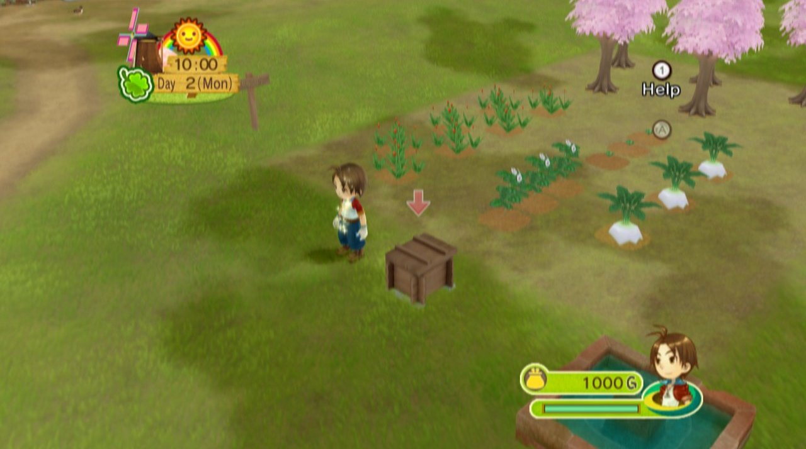
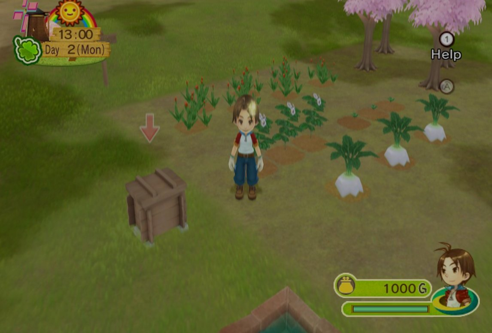
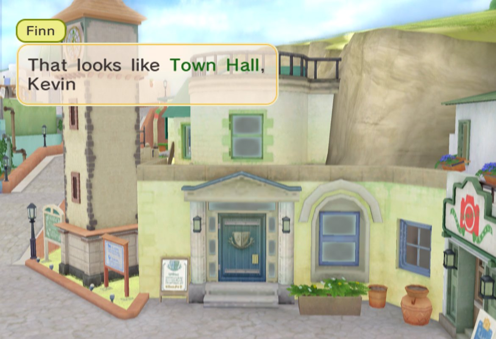

# Harvest Moon: Animal Parade – native PC port

[Español](README.es.md)

A native PC port of *Harvest Moon: Animal Parade* (Wii) by static recompilation: the game's
PowerPC code is translated to C++ and compiled for your computer, and the Wii it expects is
provided by [WiiCompiled](https://github.com/patchzyy/wiicompiled)'s runtime. There is no emulator.
It follows the same path as the *Magical Melody* recompilation
([HMMMGC](https://github.com/RodoLy/hmmmgc)).

**This repository contains no game data.** You need your own disc: `Harvest Moon: Animal
Parade (USA)`, ID `RBIEE9`, revision 1 (`sys/main.dol` SHA-1
`6ca574d26858941bfd1404b0293ef84bd821ddd0`).



## What this port adds

Out of the box the game looks and plays as it did on the Wii: 4:3 picture, 30 frames per
second, English. Everything below except fast loading is a choice in the **F10** menu.

| | |
|---|---|
| **Native on Windows x64 and Windows on ARM** | Two packages: x86-64, and ARM64 for Snapdragon X laptops, so the game runs natively instead of through x86-64 emulation. |
| **Wide picture** | *F10 > Graphics > Picture > Wide* fills a widescreen window: the 3D cameras see more at the sides, and the menus and text keep their shape in the middle. |
| **Frame interpolation** | The game runs at 30 FPS; *F10 > Graphics > Frame interpolation* shows 60, 120 or 180 FPS by inserting frames in between. The game's own speed does not change. |
| **Fast loading** | Always on: the black screens between areas go by four times faster. Holding **Tab** fast-forwards everything (off by default; turn it on in F10). |
| **Five languages** | English, Spanish, French, German and Italian from the same US disc (see below). |
| **Direct3D 12 or Vulkan** | *F10 > Graphics > Graphics API*. *Automatic* picks Direct3D 12. |
| **No Wii Remote needed** | An emulated Wii Remote with Nunchuk driven by a gamepad or the keyboard; the mouse is the pointer. A real Wii Remote can be paired instead. |

| Original (4:3) | Wide |
|---|---|
|  |  |



### Languages, and why the US disc has them

The US disc already carries the game's text in five languages: `files/msglang/`, `talk_la/`,
`event_la/`, `param_la/` and `cg_la/` each have `eng`, `spa`, `fre`, `ger` and `ita` folders
(plus `bri`, British English). The European and US releases share that text; the US game
just never uses it, because its function that picks the language (0x8010FF04) always answers
English. The port answers it, and the Wii's own `SCGetLanguage`, with the language you choose
in *F10 > Graphics > Language*. Restart the game after changing it.

Known issue: in any language other than English the title screen shows the Japanese logo. The
US disc only has the Japanese and the English logos; the European logo is not on it.

## Play on Windows

1. In the **Actions** tab, run **Windows x64 package** or, on a Windows on ARM PC,
   **Windows ARM64 package**, and download the package (it has no game data).
2. Unzip it to a short folder, such as `C:\HMAP`.
3. Double click `play.cmd` and choose your disc image (.rvz, .iso or .wbfs). The first time
   it extracts the disc, translates the game and compiles it; then the game starts.

The full steps are in [packaging/windows/README.txt](packaging/windows/README.txt). Settings,
saves and logs are in `UserData\`.

## Frequently asked questions

**The first start takes several minutes.** The first time, `play.cmd` extracts the disc,
translates the game's code and compiles it. Later starts only build what changed.

**The game runs slowly on a Windows on ARM laptop (Snapdragon X).** Use the ARM64 package. The
x64 package also works there, but through x86-64 emulation, which is slower.

**The picture is split down the middle, or things blink (Snapdragon X / Adreno GPU).** That is
an old Adreno graphics driver with Direct3D 12. Update the driver with the *Snapdragon Control
Panel* app (Microsoft Store) or your laptop maker's support app.

**Vulkan stops with "Device lost", runs slowly or shows wrong colors.** Some GPUs, Adreno among
them, only give Vulkan a reduced mode. Switch to Direct3D 12 (*Automatic* in
*F10 > Graphics > Graphics API*) and restart.

**The FPS counter says 30.** The game runs at 30 frames per second, as on the Wii. Turn on
*Frame interpolation* in F10 to see 60, 120 or 180 FPS.

**With frame interpolation the counter stays under the chosen FPS in some areas.** In heavy
areas, when a frame of the game is late there is no frame to insert for it. The game's speed
does not change; lower the interpolation or the resolution if it bothers you.

**Something looks wrong at the edges, or a menu looks stretched, with the wide picture.** The
game was made for 4:3. Choose *Original (4:3)* in *F10 > Graphics > Picture* and please report
where it happened.

**I changed the language and nothing changed.** Restart the game: it reads the language once,
while it starts.

**The title screen shows the Japanese logo.** In any language other than English the US disc
only has the Japanese logo to show (see *Known issue* above).

**How do I use the Wii Remote pointer?** With the mouse: it is the pointer, left click is A and
right click is B. Controller and keyboard buttons can be changed in F10.

**Where are my saves?** In `UserData\NAND\`, next to the settings (`UserData\Config.toml`).
Copy the whole `UserData` folder to keep them.

**The game closed with a message.** The message says why. Please open an issue with it and the
newest folder in `UserData\Logs`.

**Are there cheats?** Not for now. Codes that change the game's instructions cannot work in a
recompiled game, and the ones that only change values in memory need addresses that are still
being found.

## For developers

You need Python 3.11+.

```sh
python3 -m pip install -r requirements-dev.txt   # capstone, pytest, ruff

# 1. Extract your disc into orig/RBIEE9 (in Dolphin: right-click the game →
#    Properties → Filesystem → right-click the data partition →
#    Extract Entire Partition) and check that it is the target binary
python3 tools/check_disc.py

# 2. Regenerate the function map and run the tests
python3 tools/analyze.py
python3 -m pytest

# 3. Read any function
python3 tools/disasm.py OSInit
```

On Windows use `py` instead of `python3`. On a PC with an ARM processor, install the **x64**
Python: `capstone` publishes no prebuilt package for Windows ARM64.

How the port works: [docs/NATIVE_RUNTIME.md](docs/NATIVE_RUNTIME.md) (the runtime and every
change made for this game), [docs/FUNCTION_MAP.md](docs/FUNCTION_MAP.md) (the function map,
17,142 functions) and [docs/PLAN.md](docs/PLAN.md).

## Related repositories

- **[HMMMGC](https://github.com/RodoLy/hmmmgc)**: the tools in `tools/` and the tests come
  from there. They worked unchanged on this game.
- **The Animal Parade research repository** (decompilation): the disc layout, the original
  file and class names, and the hidden developers' menu.

## License

GNU General Public License, version 3 or later (GPL-3.0-or-later), like HMMMGC, ModernGekko
and DolRecomp. The full text is in [LICENSE](LICENSE). The game is not included or
distributed; the screenshots are from the port running a legally owned disc.
